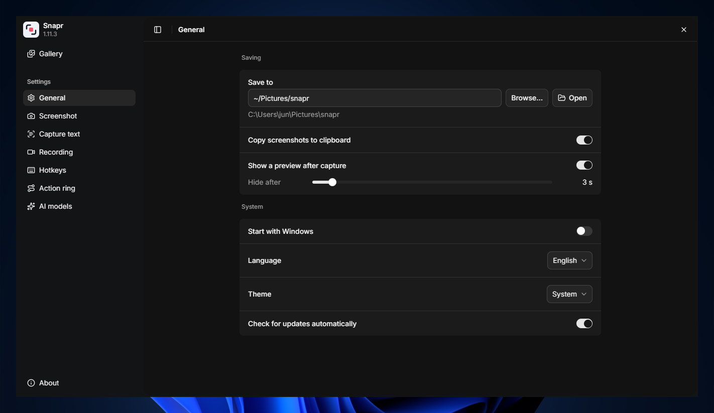
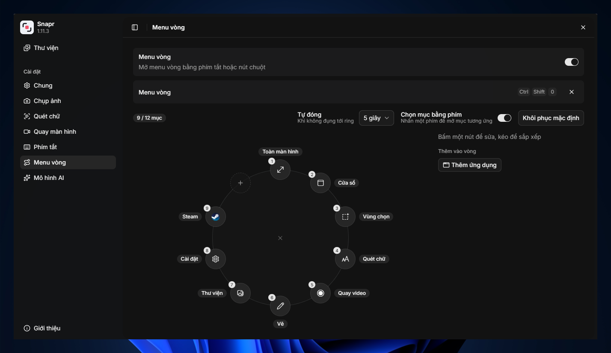

<p align="center">
  
</p>

<h1 align="center">Snapr</h1>

<p align="center">
  A small Windows tray app for screenshots, screen recording and text capture.<br>
  Everything runs locally: no account, no cloud, no telemetry.
</p>

<p align="center">
  <a href="https://github.com/quanvudev/snapr-releases/releases/latest">Download</a> ·
  <a href="CHANGELOG.md">Changelog</a>
</p>

<p align="center">
  
</p>

---

## Features

**Screenshots**
- Capture the full screen, a single window (with its rounded corners) or a dragged area, across every monitor.
- Annotate an area before saving: rectangles, ellipses, arrows and text, with colours, fill, widths, undo / redo, and a selection you can resize or move.
- Hide sensitive information: black or pixelated redaction boxes, one-click detection of emails, phone numbers, card numbers, IP addresses, API keys and your own patterns, and optional automatic redaction of full-screen and window captures.
- Optional padding around captures, with a transparent background, your desktop wallpaper or any image.
- A preview toast after every capture, and pins: float any screenshot on top of your other windows.

**Screen recording**
- Record the full screen, a window or an area to MP4 (H.264), at 30 or 60 fps with three quality levels.
- Microphone and system audio, an optional round webcam overlay, a 3-second countdown, pause and resume.
- Optional automatic compression to 1080p or 720p after recording.

**Text and QR codes**
- Select an area to copy its text, or the content of any QR code in it, to the clipboard.
- Uses Windows OCR, or an optional local PaddleOCR model.

**Transcripts and subtitles**
- Transcribe the speech in a recording to an `.srt` file with a local Whisper model (Base, Small or Large v3 Turbo).
- Edit the transcript in the viewer and burn it into a copy of the video as subtitles, with your choice of position, size, text colour and background (or outlined text with no background). Japanese, Chinese, Korean, Thai and Hindi subtitles use a Windows font that has their characters.
- Translate subtitles into 38 languages on your machine with the optional HY-MT1.5 model (Vietnamese ⇄ English by default), or into English with Whisper; every translation is its own `.srt` track you can edit and export.

**Gallery**
- Browse every capture and recording by day, month or year, search by name, and open them in a built-in viewer.
- Copy, pin or delete in bulk, extract text from a photo, export a video clip as a GIF, compress or transcribe videos, and follow the long-running work in a background task queue.

**And also**
- Global hotkeys (keyboard or mouse buttons) and an Action Ring that puts every action one click away.
- Light and dark themes, English and Vietnamese.
- Updates itself from GitHub releases, with signed downloads.

## Install

Requires 64-bit Windows 10 or 11. Windows 11 is recommended: recording system audio uses an API that older Windows 10 builds lack.

**Installer:** download `Snapr_<version>_x64-setup.exe` from the [latest release](https://github.com/quanvudev/snapr-releases/releases/latest). It installs for the current user only and needs no administrator rights.

**Scoop:**

```powershell
scoop bucket add snapr https://github.com/quanvudev/snapr-releases
scoop install snapr
```

**Portable:** the bare `Snapr_<version>_x64.exe` from the same release runs without installing.

## Guide

### First run

Snapr opens a short setup the first time: pick where captures are saved (`Pictures\snapr` by default) and check the hotkeys. After that it lives in the system tray. Click the tray icon for its menu: Gallery, Settings, Open folder and the recording controls; closing the settings window only hides it.

### Hotkeys

| Action | Default |
| --- | --- |
| Full screen (monitor under the cursor) | `Win+Shift+1` |
| Window | `Win+Shift+2` |
| Area | `Win+Shift+3` |
| Text capture | `Win+Shift+4` |
| Recording panel / stop recording | `Win+Shift+5` |
| Area with annotations | `Win+Shift+6` |
| Action Ring | not set |

Change them in Settings → Hotkeys. By default every slot shares one modifier prefix (`Win+Shift`) and a key; switch to manual mode to give each action its own full combination. The Action Ring can also be bound to a mouse button (middle, back or forward).

### Taking screenshots

- **Window:** hover a window to highlight it, click to capture. **Area:** drag a rectangle. `Esc` cancels.
- The image is saved as a PNG, copied to the clipboard (Settings → General) and shown in a preview toast. Hover the toast and click **Pin** to float the screenshot on top of other windows; drag a pin to move it, hover it to copy or close it.
- Settings → Capture adds padding around every capture, with a transparent, wallpaper or image background.

### Annotating

Press the annotation hotkey and drag an area. A toolbar appears under the selection:

| Key | Action |
| --- | --- |
| `R` `C` `A` `T` | Rectangle, ellipse, arrow, text |
| `X` | Redact (black or pixelate) |
| `D` | Detect sensitive text in the selection and cover it |
| `F` | Toggle fill for rectangles and ellipses |
| `[` `]` | Thinner / thicker, or smaller / larger text |
| `Shift` + drag | Square, circle, or arrow snapped to 45° |
| `Space` + drag | Move the selection (drag its handles to resize it) |
| `Ctrl+B` `Ctrl+I` | Bold, italic text |
| `Ctrl+Z` `Ctrl+Y` | Undo, redo |
| `Delete` | Delete the selected shape |
| `Ctrl+C` | Copy to the clipboard only |
| `Ctrl+P` | Pin to the screen |
| `Enter` / `Ctrl+S` | Save |
| `Esc` | Close the palette, deselect, then cancel |

Click a shape's outline to select and move it; the toolbar then edits that shape's colour and size.

### Redaction

In an annotation, the Redact tool (`X`) draws black or pixelated boxes, and **Detect** (`D`) reads the text in the selection and covers every email address, phone number, card number (Luhn checked), IPv4 address and secret (API keys such as `sk-…` or `ghp_…`, JWTs, long tokens and hashes). The boxes are ordinary shapes: delete a wrong one, or undo the whole batch with `Ctrl+Z`. Saved, copied and pinned images contain the redaction burned in.

Settings → Capture → Redaction turns on **automatic redaction of full-screen and window captures** (off by default): the image is covered before it is saved, copied or previewed, and the original is not kept. The same card picks the default style, the categories to look for, your own regular expressions (for example `EMP-\d{6}`), and the text recognition: Windows OCR (fast, about 0.1 s) or PaddleOCR (more accurate, a few seconds per capture). Detection is an aid, not a guarantee: text the OCR cannot read is not covered.

### Recording

1. Press the recording hotkey (or use the Action Ring). A panel opens at the bottom of the screen.
2. Choose the mode (full screen, window or area), the microphone and system audio, and a camera if you want a webcam bubble.
3. Click **Start**, then pick the window or drag the area. An area being recorded gets a thin border that is not recorded.
4. Pause, resume, stop or discard from the panel or the tray menu. Pressing the hotkey again stops.

Settings → Recording sets the frame rate, quality and countdown, and what happens after recording: compress to 1080p / 720p, transcribe the speech, and translate the subtitles.

### Text and QR codes

Press the text hotkey and drag over any text. If the area contains a QR code its content is copied, otherwise the recognised text is; a notification confirms it. Windows OCR uses the languages installed in Windows (Settings → Text links to the language settings); switch to PaddleOCR there for better accuracy on screenshots.

### Gallery

Open it from the tray. Captures are grouped by day, month or year and filtered by type or name.

- Click a tile to open the viewer: `←` `→` to browse, `Ctrl+C` to copy, `P` to pin, `Delete` to delete, scroll or `+` `-` `0` to zoom.
- Right-click a tile for more actions: Export GIF (trim, width and frame rate), Compress video, Transcribe, Translate subtitles, Export with subtitles, Extract text. Video tiles show a badge for each subtitle language they have.
- Long-press or `Ctrl`-click to select several, `Shift`-click for a range, `Ctrl+A` for all, then act on them from the bar at the bottom.
- In the viewer, `T` opens a video's transcript: click a line to jump to it, double-click to edit it, and switch between the original and its translations.
- Long-running work (GIF, compression, transcription, translation, subtitles) runs in a background queue; the list icon next to the close button shows progress, history and retry.

### Action Ring

<p align="center">
  
</p>

Turn it on in Settings → Action Ring and give it a hotkey or a mouse button. It opens around the cursor with every action one click away: captures, recording, Gallery and Settings. Choose which items it shows and how long it waits before closing.

## AI models

Text capture works out of the box with Windows OCR. PaddleOCR, Whisper and HY-MT1.5 are optional: Snapr downloads a model only when you turn on the feature that needs it, verifies each file against a pinned SHA-256 and runs it on your machine through ONNX Runtime. Manage and delete them in Settings → AI models.

**Hardware acceleration.** Settings → AI models detects your graphics card and can run the models on it instead of the processor. Auto (the default) uses the fastest runtime you have already downloaded and never downloads anything itself; CPU, DirectML and CUDA pick one explicitly. A new choice applies after Restart snapr, and if the card fails a task runs again on the processor.

| Runtime | Download | Runs on the graphics card | Example on an RTX 5060 Ti |
|---|---|---|---|
| CPU | included | nothing | 8-minute video, Large v3 Turbo: 121 s |
| DirectML (any recent card) | about 25 MB | PaddleOCR (6 to 7 times faster) | Whisper and translation stay on the processor |
| CUDA (NVIDIA only) | about 1 GB | PaddleOCR, Whisper and HY-MT1.5 | same video: 16 s; 100 subtitle lines translated in 6.5 s instead of 45 s |

With CUDA, Snapr also downloads a GPU version of the selected Whisper model (fp16, or q4f16 for Turbo). Translation now works on several subtitle lines at a time on every computer, which made it about a third faster on the processor too.

HY-MT1.5 1.8B (about 1.4 GB, used for subtitle translation) is licensed by Tencent under the Tencent HY Community License, not an open source licence: it does not apply in the European Union, the United Kingdom or South Korea, and its output must not be used to improve other AI models. Snapr shows the licence and asks you to agree before the first download. Tencent is not affiliated with Snapr.

## Build from source

Requirements: [Bun](https://bun.sh), [Rust](https://rustup.rs) (stable, MSVC toolchain) and the [Tauri prerequisites for Windows](https://tauri.app/start/prerequisites/).

```powershell
bun install
bun run tauri dev     # run in development
bun run tauri build   # release build (NSIS installer)
```

A release build signs its update artifacts, so it needs `TAURI_SIGNING_PRIVATE_KEY` and `TAURI_SIGNING_PRIVATE_KEY_PASSWORD`; for a local build without them, set `"createUpdaterArtifacts": false` in `src-tauri/tauri.conf.json`.

Built with [Tauri 2](https://tauri.app), Rust, React 19, TypeScript, Tailwind CSS and shadcn/ui. See [CLAUDE.md](CLAUDE.md) for an overview of the architecture.

## Contributing

Feedback, ideas and pull requests are welcome.

- Found a bug or have an idea? [Open an issue](https://github.com/quanvudev/snapr/issues/new/choose): there are templates for bug reports, feature requests and general feedback.
- Want to contribute code? Read [CONTRIBUTING.md](CONTRIBUTING.md). Every change goes through a pull request to `master`.

## License

[MIT](LICENSE)

## Author

Made by Jun ([@quanvudev](https://github.com/quanvudev)).
